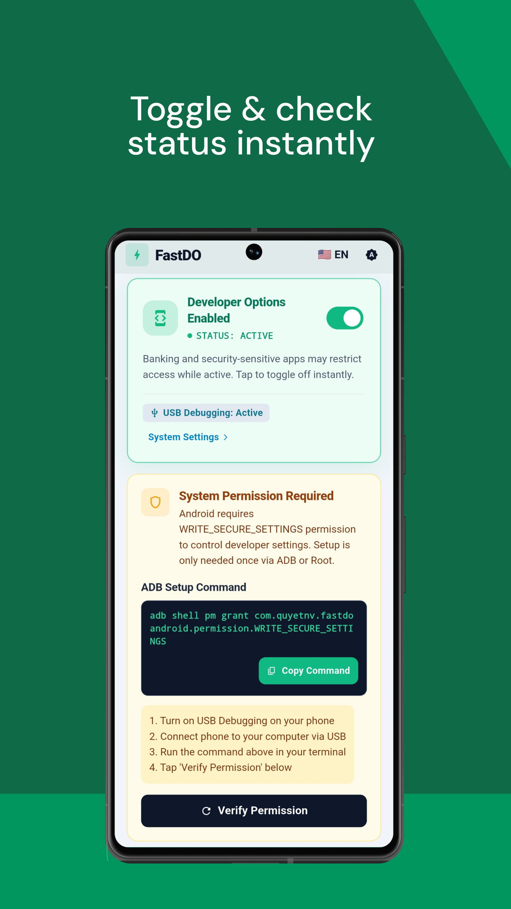
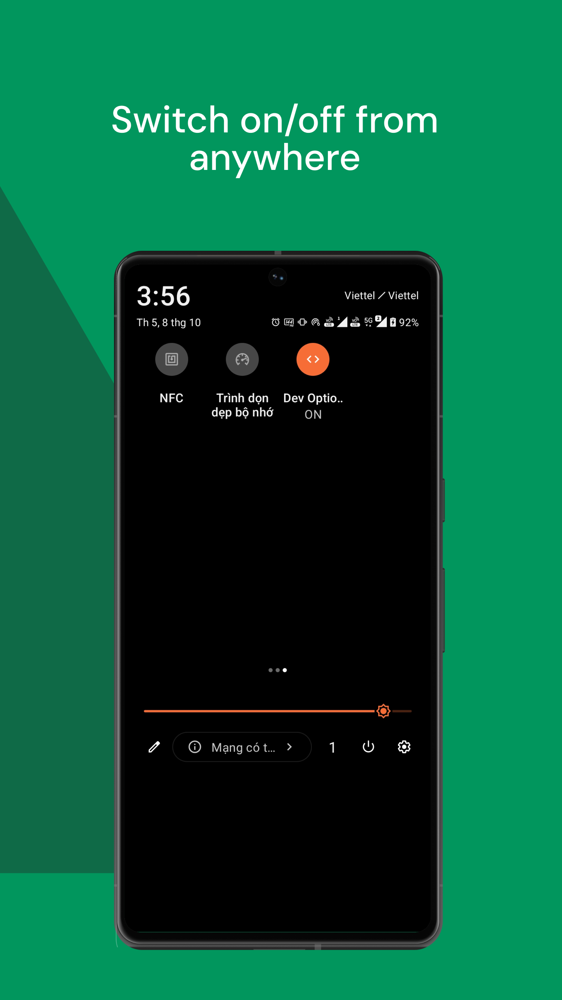

<p align="center">
  <br />
  <h1 align="center">⚡ FastDO</h1>
  <p align="center">
    <b>One-Tap Quick Settings Toggle for Android Developer Options & Wireless ADB</b>
  </p>
  <p align="center">
    <i>Instantly toggle Developer Options & Wireless Debugging with 1 tap — Bypass banking app restrictions and debug over Wi-Fi without breaking your flow.</i>
  </p>
  <p align="center">
    <a href="https://github.com/quyetnv-mlhn/fastdo/releases"></a>
    <a href="LICENSE"></a>
    
    
    
    
  </p>
  <br />
</p>

---

## 📌 Table of Contents

- [Overview](#-overview)
- [Screenshots](#-screenshots)
- [The Problem vs The Solution](#-the-problem-vs-the-solution)
- [Key Features](#-key-features)
- [Quick Settings Tiles Setup](#-quick-settings-tiles-setup)
- [One-Time Permission Setup](#-one-time-permission-setup)
- [Wireless Debugging Workflow](#-wireless-debugging-workflow)
- [Clean Architecture & Project Structure](#-clean-architecture--project-structure)
- [Tech Stack & Standard Libraries](#-tech-stack--standard-libraries)
- [Build from Source & Makefile](#-build-from-source--makefile)
- [CI/CD & Automated Releases](#-cicd--automated-releases)
- [Privacy & Security Guarantee](#-privacy--security-guarantee)
- [Contributing & License](#-contributing--license)

---

## 📖 Overview

**FastDO** is an open-source, lightweight Android utility crafted specifically for mobile developers. It provides instant 1-tap toggles from the **Android Quick Settings panel (Notification Shade)** and an intuitive in-app dashboard for:

1. **Developer Options** (`Settings.Global.DEVELOPMENT_SETTINGS_ENABLED`): Instantly disable developer options when opening banking, fintech, or enterprise security apps, and turn them back on the moment you return to coding.
2. **Wireless Debugging (Wi-Fi ADB)** (`Settings.Global.ADB_WIFI_ENABLED`): Toggle Wireless ADB without plugging in a USB cable. FastDO automatically discovers the device's local Wi-Fi IP and dynamic pairing port via mDNS and local system properties, giving you ready-to-run `adb connect <ip>:<port>` commands with 1 click.

---

## 📱 Screenshots

<p align="center">
  
  &nbsp;&nbsp;&nbsp;&nbsp;
  
</p>

---

## 💡 The Problem vs The Solution

### 🛑 The Pain Points

- **Banking App Lockouts:** As mobile engineers, Developer Options is virtually always turned on. However, banking, crypto, and enterprise apps detect this setting and block access. Navigating through 6+ nested menus in Android Settings to turn it off and on repeatedly disrupts your workflow.
- **Wireless ADB Friction:** Android's native Wireless Debugging assigns a randomized 5-digit port every time it restarts. Developers must manually navigate into `Settings` ➔ `Developer Options` ➔ `Wireless debugging`, read the port, and type `adb connect <ip>:<port>`.

### 🚀 The FastDO Way

| Scenario | Traditional Way 😫 | FastDO Way ⚡ |
| :--- | :--- | :--- |
| **Bypass Bank App Restrictions** | 1. Open device **Settings**<br>2. Navigate to **System**<br>3. Tap **Developer Options**<br>4. Toggle it **OFF**<br>5. Open banking app<br>6. Re-open Settings & toggle **ON** | 1. Swipe down the notification panel.<br>2. Tap **Dev Options** tile.<br><br>👉 **Done in 0.5 seconds!** |
| **Connect Wireless ADB** | 1. Open Developer Options<br>2. Scroll & tap Wireless debugging<br>3. Toggle it on<br>4. Memorize IP & random 5-digit port<br>5. Manually type `adb connect IP:PORT` | 1. Tap **Wireless ADB** tile or in-app switch.<br>2. Tap **Copy ADB Command** (`adb connect 192.168.x.x:port`).<br>3. Paste & run in terminal!<br><br>👉 **Zero manual typing!** |

---

## ✨ Key Features

- ⚡ **Dual Quick Settings Tiles**: Native system tiles for both **Developer Options** (`FastDoTileService`) and **Wireless ADB** (`FastDoWifiTileService`).
- 🚀 **1-Tap Add Tile (Android 13+ / API 33+)**: Add tiles directly from inside the app using `StatusBarManager.requestAddTileService` without manual panel editing.
- 📶 **Smart Wireless ADB & Dynamic Port Discovery**: Automatically detects device IP and resolves dynamic adb daemon ports using Root `getprop service.adb.tcp.port`, SystemProperties, port 5555 fallback, and local Android `NsdManager` mDNS (`_adb-tls-connect._tcp`).
- 🔄 **Real-Time System Synchronization**: Integrated with Android `ContentObserver` to monitor system settings changes and reflect accurate state across the app and tiles in real time.
- 🔌 **Live Status Monitoring**: Displays real-time status badges for Developer Options, USB Debugging (`ADB_ENABLED`), and Wireless Debugging.
- 🛠️ **In-App Setup Guide & Root Support**: Interactive bottom sheet guide with 1-tap ADB command copy, direct Root (`su`) grant button, and Shizuku instructions.
- 🎨 **Modern Material 3 UI**: Clean Architecture, 3-tier radius system (sharp, subtle, soft), Dark/Light theme, and bilingual support (English 🇺🇸 & Vietnamese 🇻🇳).
- 🔒 **100% Local & Zero Telemetry**: No remote servers, no cloud endpoints, no tracking, and zero ads. Network permissions are used strictly for local LAN mDNS discovery of Android's internal `adbd` service.

---

## 📱 Quick Settings Tiles Setup

FastDO provides two ways to add tiles to your Android Quick Settings panel:

### Method A: 1-Tap Add from In-App Dashboard (Android 13+ / API 33+)

1. Open **FastDO**.
2. Scroll to the **Quick Settings Tiles** card or **Wireless Debugging** card.
3. Tap **"Add Dev Options Tile"** or **"Add Wireless ADB Tile"**.
4. Confirm the system prompt dialog — the tile will be added to your active notification shortcuts immediately!

### Method B: Manual Drag-and-Drop (All Android Versions)

```
[ Swipe Down 2x ]  ➔  [ Tap Edit (Pencil Icon) ]  ➔  [ Drag "Dev Options" / "Wireless ADB" Up ]
```

1. Swipe down twice from the top of your screen to expand the Quick Settings shade.
2. Tap the **Edit** (Pencil) icon.
3. Locate **"Dev Options"** and **"Wireless ADB"** in the inactive tiles section.
4. Drag them into your active shortcuts list and enjoy 1-tap toggling!

---

## 🔑 One-Time Permission Setup

Because modifying secure Android system settings requires the `WRITE_SECURE_SETTINGS` permission, Android requires this permission to be granted **once** via ADB or Root:

### Option A: Via ADB from PC (Recommended)

1. Enable **USB Debugging** on your device (`Settings` ➔ `Developer Options` ➔ `USB Debugging`).
2. Connect your device to your computer via USB.
3. Open Terminal or Command Prompt on your computer and execute:

```bash
adb shell pm grant com.quyetnv.fastdo android.permission.WRITE_SECURE_SETTINGS
```

4. Return to FastDO and tap **"Verify Permission"** (or use the in-app permission banner).

### Option B: For Rooted Devices (Magisk / KernelSU / APatch)

If your device is rooted, open FastDO and tap **"Grant via Root (SU)"** in the setup sheet to activate the permission instantly with a single tap.

### Option C: Via Wireless Debugging / Shizuku

You can also execute the grant command on-device without a PC using tools like **Shizuku** or a local terminal emulator (such as Termux with `adb pairing`).

---

## 📶 Wireless Debugging Workflow

1. Connect your Android device and PC to the **same Wi-Fi network**.
2. Toggle on **Wireless Debugging** in FastDO (or tap the **Wireless ADB** Quick Settings tile).
3. FastDO automatically resolves your local Wi-Fi IP and dynamic adb port.
4. Tap **"Copy Command"** in the app. FastDO copies the full command:
   ```bash
   adb connect 192.168.1.50:39845
   ```
5. Paste and execute it in your PC terminal. You are now wirelessly connected!

> **Note:** If you are connecting wirelessly for the first time on Android 11+, tap **"Pair with pairing code"** inside Android's native Wireless Debugging settings (accessible via the direct shortcut button in FastDO).

---

## 🏗️ Clean Architecture & Project Structure

FastDO strictly implements **Clean Architecture** to ensure testability, scalability, and maintainability:

```text
lib/
├── core/                                   # Shared infrastructure & base design
│   ├── errors/                             # Typed Failures & Exceptions (fpdart)
│   ├── services/                           # Dependency Injection (GetIt + Injectable)
│   ├── theme/                              # AppTheme, AppColors, AppTypography, AppRadius
│   ├── utils/                              # GoRouter config, context extensions
│   └── widgets/                            # BaseCard, BaseButton, AppStatusBadge
├── data/                                   # Data Layer
│   └── dev_settings/
│       ├── datasources/                    # Native MethodChannel & EventChannel implementation
│       ├── dtos/                           # DevSettingsDto (@freezed + toDomain())
│       └── repositories/                   # DevSettingsRepositoryImpl (Either<Failure, T>)
├── domain/                                 # Domain Layer (Pure Dart)
│   └── dev_settings/
│       ├── models/                         # DevSettingsInfo Entity (@freezed)
│       ├── repositories/                   # IDevSettingsRepository (Abstract contract)
│       └── usecases/                       # Single-responsibility UseCases (@lazySingleton)
│           ├── get_dev_settings_status_usecase.dart
│           ├── toggle_dev_options_usecase.dart
│           ├── toggle_wifi_debugging_usecase.dart
│           ├── request_add_tile_usecase.dart
│           ├── request_add_wifi_tile_usecase.dart
│           ├── open_dev_settings_usecase.dart
│           ├── open_wireless_debugging_settings_usecase.dart
│           ├── grant_root_permission_usecase.dart
│           └── watch_dev_settings_usecase.dart
├── presentation/                           # Presentation Layer
│   ├── bloc/                               # AppSettingsCubit (ThemeMode & Locale)
│   ├── dev_settings/
│   │   ├── bloc/                           # DevSettingsCubit & DevSettingsState
│   │   ├── pages/                          # HomePage (StatelessWidget)
│   │   └── widgets/                        # Modular sub-widgets (< 300 LOC)
│   │       ├── status_hero_card.dart       # Developer Options Hero toggle
│   │       ├── wireless_debugging_card.dart# Wireless ADB status & connect helper
│   │       ├── quick_settings_tile_card.dart# Tile mockup preview & 1-tap add
│   │       ├── app_permission_sheet.dart   # Interactive setup modal sheet
│   │       ├── permission_banner.dart      # Real-time permission warning banner
│   │       └── privacy_card.dart           # Offline & security guarantee card
│   └── l10n/                               # ARB Localizations (app_en.arb, app_vi.arb)
├── app.dart                                # MaterialApp.router + GoRouter + L10n config
└── main.dart                               # App bootstrap & DI initialization

android/app/src/main/kotlin/com/quyetnv/fastdo/
├── MainActivity.kt                         # Flutter engine bridge, MethodChannel & EventChannel
├── DevSettingsHelper.kt                    # System settings reader/writer & ContentObserver
├── FastDoTileService.kt                    # Native Quick Settings Tile for Dev Options
├── FastDoWifiTileService.kt                # Native Quick Settings Tile for Wireless ADB
└── AdbPortFinder.kt                        # Dynamic wireless ADB port discovery via mDNS / getprop
```

---

## 🧰 Tech Stack & Standard Libraries

- **State Management:** `flutter_bloc`
- **Dependency Injection:** `get_it` + `injectable`
- **Routing:** `go_router`
- **Immutability & Serialization:** `freezed` + `json_serializable`
- **Functional Error Handling:** `fpdart` (`Either<Failure, T>`)
- **Localization:** `flutter_localizations` with ARB files (`app_en.arb`, `app_vi.arb`)

---

## 🚀 Build from Source & Makefile

### Prerequisites
- [Flutter SDK](https://flutter.dev/) `^3.27.x` or [FVM](https://fvm.app/)
- Android SDK & Platform Tools (API 24+)

### Build Commands

```bash
# 1. Clone the repository
git clone https://github.com/quyetnv-mlhn/fastdo.git
cd fastdo

# 2. Setup dependencies & generate code
fvm flutter pub get
fvm flutter gen-l10n
fvm dart run build_runner build --delete-conflicting-outputs

# 3. Run static analysis & test suite
fvm flutter analyze
fvm flutter test

# 4. Build Release APK
fvm flutter build apk --release
```

### 🛠️ All-in-One Makefile Commands

FastDO includes a comprehensive `Makefile` for streamlined development:

```bash
make all        # 🔥 Clean cache + get deps + gen code + format + analyze + test
make init       # 🚀 Initialize project from scratch (clean + setup + check)
make dev        # 🚀 Run all setup, verification, and launch app on connected device
make setup      # Install dependencies & generate all code (L10n + build_runner)
make check      # Complete quality pipeline (fix + format + analyze + test)
make gen        # Run code generation (gen-l10n + build_runner)
make build-apk  # Build optimized Android Release APK
make grant-adb  # Grant WRITE_SECURE_SETTINGS to connected device via ADB
```

---

## 🤖 CI/CD & Automated Releases

FastDO includes production-grade **GitHub Actions workflows**:
- **`ci.yml`**: Runs code format verification, static analysis (`flutter analyze`), and unit/widget tests on every push and pull request.
- **`release.yml`**: Automatically builds the release APK and publishes a new GitHub Release when a version tag is pushed:

```bash
git tag v1.0.4
git push origin v1.0.4
```

---

## 🔒 Privacy & Security Guarantee

- **100% Local Execution:** FastDO has no remote backend servers, no cloud APIs, and sends zero telemetry or tracking data.
- **Transparent Permissions:**
  - `WRITE_SECURE_SETTINGS`: Required strictly to toggle `DEVELOPMENT_SETTINGS_ENABLED` and `ADB_WIFI_ENABLED`.
  - `ACCESS_WIFI_STATE`, `CHANGE_WIFI_MULTICAST_STATE`, `INTERNET`: Required solely for local network mDNS discovery (`NsdManager` / `_adb-tls-connect._tcp`) to detect Android's local adb daemon port on the local Wi-Fi subnet.
- **Minimal Footprint:** FastDO modifies only the settings you explicitly toggle.

---

## 📄 Contributing & License

Contributions are welcome! Please check out [CONTRIBUTING.md](CONTRIBUTING.md) and [PRIVACY.md](PRIVACY.md) before submitting pull requests.

This project is licensed under the **MIT License** - see the [LICENSE](LICENSE) file for details.

Developed with ❤️ by **[QuyetNV](https://github.com/quyetnv-mlhn)**.
